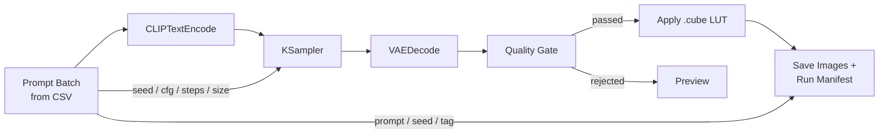

# comfyui-production-nodes

Four small ComfyUI nodes for the unglamorous part of generative production: running a
batch from a brief, throwing out the bad frames, matching the grade, and proving later how
each frame was made. Written against the **V3 node API** (`comfy_api.latest`), no extra
dependencies, no models to download.



| node | production problem it solves |
|---|---|
| **Prompt Batch from CSV** | Briefs arrive as spreadsheets. One row per queued run, typed outputs (prompt, negative, seed, cfg, steps, width, height, tag), errors that name the line and column. |
| **Quality Gate** | Nobody should hand-review 400 frames to find the black, blown-out or mushy ones. Model-free metrics, configurable thresholds, a JSON report, and a graph that never breaks on an empty batch. |
| **Apply .cube LUT** | Generated frames must sit next to graded footage. Applies the same `.cube` the colourist uses, trilinear on GPU, with intensity. |
| **Save Images + Run Manifest** | "Which seed was the approved one?" A JSON sidecar per image with prompt, seed, params, a hash of the exact graph and a hash of the workflow structure. |


*Synthetic chart (generated by `scripts/make_assets.py`): original, `teal_orange`, `bleach_bypass`.*

## Install

```bash
cd ComfyUI/custom_nodes
git clone https://github.com/thejunglefruit/comfyui-production-nodes
```

Restart ComfyUI. The nodes appear under **jungle_fruit/** in the node menu. Nothing to
`pip install`: torch, numpy and Pillow already ship with ComfyUI. Requires a ComfyUI recent
enough to expose `comfy_api.latest` (V3 nodes). Put your own LUTs in `ComfyUI/models/luts/`.

The repository also carries `[tool.comfy]` metadata in `pyproject.toml` for publishing to
the Comfy Registry.

## Nodes

### Prompt Batch from CSV · `JungleFruit_PromptBatchCSV`

| inputs | outputs |
|---|---|
| `csv_path` (file in `input/`) or `csv_text` (pasted) | `prompt`, `negative` STRING |
| `index` INT with **increment** control | `seed`, `steps`, `width`, `height` INT |
| `on_overflow`: wrap / clamp / error | `cfg` FLOAT, `tag` STRING |
| defaults for optional columns (advanced) | `row_index`, `total_rows` INT |

Required columns `prompt, negative, seed`; optional `cfg, steps, width, height, tag`.
Queue the workflow *N* times and the index walks the sheet. [Details](docs/JungleFruit_PromptBatchCSV.md)

### Quality Gate · `JungleFruit_QualityGate`

| inputs | outputs |
|---|---|
| `images` IMAGE | `passed` IMAGE |
| `min_sharpness` (Laplacian variance) | `rejected` IMAGE |
| `min_brightness`, `max_brightness` | `report` STRING (JSON) |
| `max_clipped_highlights`, `max_crushed_shadows` | `pass_count` INT |
| `min_contrast`, `if_none_pass` | |

**Empty-batch policy.** An empty branch is never emitted as a zero-length tensor; it is
blocked silently, so nodes hanging off it skip that run without an error. If nothing passes,
`return_best` (default) sends the best-scoring image through `passed` and flags
`"fallback_used": true` in the report (`pass_count` stays 0); `block` skips the branch.
[Details](docs/JungleFruit_QualityGate.md)

### Apply .cube LUT · `JungleFruit_ApplyCubeLUT`

| inputs | outputs |
|---|---|
| `image` IMAGE (RGB or RGBA) | `image` IMAGE |
| `lut_name` from `models/luts` and the pack's `luts/` | |
| `intensity` 0-1 | |
| `lut_path` override (advanced, sandboxed) | |

Supports `TITLE`, `LUT_3D_SIZE`, `DOMAIN_MIN/MAX`, `LUT_3D_INPUT_RANGE`. Two example looks
are included, computed from formulas so there is no third-party LUT licence involved.
[Details](docs/JungleFruit_ApplyCubeLUT.md)

### Save Images + Run Manifest · `JungleFruit_RunManifest`

| inputs | outputs |
|---|---|
| `images` IMAGE, `filename_prefix` | `manifest` STRING (JSON) |
| `positive`, `negative`, `seed`, `tag` | UI: saved images |
| `params` (JSON or `key=value` lines) | |
| `include_graph`, `include_workflow` | |
| hidden: `PROMPT`, `EXTRA_PNGINFO` | |

Writes `name_00001_.png` + `name_00001_.json`. `prompt_sha256` identifies the run;
`graph_sha256` ignores widget values and identifies the workflow. No host, user or path data
is recorded. [Details](docs/JungleFruit_RunManifest.md)

## Example

`examples/production_batch_workflow.json` (drag into ComfyUI) and
`examples/production_batch_api.json` (for `POST /prompt`) wire all four nodes around a
standard SDXL text-to-image graph. Copy `examples/prompts.csv` to `ComfyUI/input/`, pick
your checkpoint, and queue as many runs as the sheet has rows.

## Design

```
__init__.py              V3 entry point: ComfyExtension + comfy_entrypoint()
jf_nodes/core/           pure logic, no ComfyUI imports (CSV, metrics, LUT maths, manifest)
jf_nodes/nodes/          thin io.ComfyNode wrappers: schema, validation, caching, UI text
luts/                    example looks, generated by scripts/make_assets.py
scripts/                 asset generator and a ComfyUI load/smoke test
tests/                   pytest, CPU only
```

- **Testable without ComfyUI or a GPU.** All behaviour lives in `jf_nodes/core`; the node
  classes only translate between widgets and that logic.
- **Caching that follows the files.** The CSV and LUT nodes fingerprint file contents and
  modification time, so editing the sheet or the LUT re-runs the node; nothing else does.
- **Paths are untrusted.** File inputs must resolve inside ComfyUI's `input/` or `luts`
  folders, which matters on shared or cloud ComfyUI servers.
- **Readable failures.** Every error names the node, the line or column, and what was expected.

## Tests

```bash
pip install pytest
python -m pytest            # 55 tests, CPU only, no ComfyUI needed
python scripts/check_comfy_load.py /path/to/ComfyUI   # load + smoke-test inside a real install
```

The unit tests cover CSV parsing and errors, the metrics on synthetic sharp / blurred /
burnt / black frames, LUT identity, a known inverting LUT, channel order, an independent
numpy trilinear reference, domain handling, malformed `.cube` files, manifest hashing and
atomic writes, and path sandboxing. The load script imports the pack the way ComfyUI does,
builds every schema, validates the example API workflow with ComfyUI's own validator and
runs each node once on synthetic data in a temporary folder.

## Licence

GPL-3.0-or-later (see `LICENSE`).
